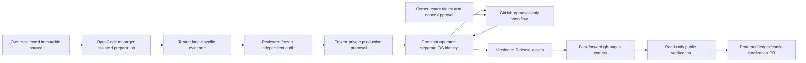

# Phase D: exact-proposal publication architecture

Status: **DESIGN FOR OWNER REVIEW — implementation and activation not authorized**.
Audit date: 2026-10-23 UTC. This document adds no tool grant, credential, workflow,
policy exception or publication authority. A–C remain local, unactivated work.

## 1. Recommendation and audited starting state

Extend the existing Toolkit/OpenCode lifecycle with a frozen production proposal,
an authenticated owner approval, and a narrow one-shot publication operator.
Keep private packages/evidence local. Use a protected GitHub Actions workflow as
the approval surface; the workflow itself has no production-write credentials.
Run the operator under a separate locked OS identity with a private immutable
proposal store and durable transaction journal. No new agent framework, daemon,
webhook receiver, scheduler or artifact-storage service is needed.

The operator is a proposed deployment boundary, not another model role. Existing
manager/tester/reviewer roles prepare and assess releases; none gains general
GitHub writes, access to operator keys, approval powers or a shell. The owner
reviews one exact proposal in GitHub. OpenCode then requests the already approved
operation, reads its status and reports results without routine Codex involvement.
This deployment choice needs separate owner approval and OS-boundary testing.
If that boundary cannot be established, publication stays disabled; placing keys
beside the present same-user adapters is not an acceptable substitute.

Read first: [original design](OPENCODE-PRODUCTION-LIFECYCLE-DESIGN.md),
[A/B report](OPENCODE-LIFECYCLE-AB-IMPLEMENTATION.md),
[C report](OPENCODE-LIFECYCLE-C-IMPLEMENTATION.md),
[integration](../docs/AGENT-INTEGRATION.md),
[approval contract](../docs/APPROVAL-CONTRACT.md), and
[release workflow](../docs/RELEASE-WORKFLOW.md). These remain authoritative.

| Inspected component | Current capability / limitation | Phase D consequence |
| --- | --- | --- |
| Local canonical main | `f2d8f3330d76a982d6f66601d8ec6ae2bc9c9c83`, clean; remote main `d6e1359a6668e688891359869ef2c7d34bc2ddff` | Pending documentation commit and A–C need separately approved source adoption; no push implied |
| GitHub destination | Public `kcook98765/ai-kodi-repository`, numeric ID `1428864210` | Bind numeric owner/repository identities as well as names and URLs |
| Pages | HTTPS enforced; legacy branch `gh-pages`, root `/`; head `e66f5f6ac88450b92a5d1c5a2d43be70b86c513f`; built | Preserve branch publication and existing static paths |
| Protection | Both branches unprotected; protection GETs explicitly 404; rulesets empty | Required bootstrap work before a production operator may activate |
| Environments | `github-pages` has branch policy only, no required reviewer; admin bypass allowed | Current environment is insufficient owner authorization |
| Actions | Default token read-only; PR review approval disabled; only dynamic Pages workflow | Add a reviewed approval-only workflow later; retain read-only defaults |
| Existing Release | `tastemade-0.1.0`, ID `421485828`, `immutable=false`; three uploaded assets with recorded SHA-256 | Preserve existing assets; qualify immutability for future releases; resolve annotated tags to commits rather than trust `target_commitish=main` |
| CLI operator identity | Repository GET reports admin/push authority | Do not hand this ambient account/token to OpenCode or the new operator |
| Builder / independent auditor | Deterministic ZIP/site, dependency/lane checks, complete inventories, SHA sidecars, retention and versioned approval contract | Extend and reuse; no replacement packager or approval policy |
| Existing plan | `publication_authorized=false`; installer-oriented `proposed_tag`; release-assets contains retained history | Add a distinct execution proposal with typed per-release upload deltas |
| Existing preflight | Production-only admission, independent audit, source/site scans, loopback/bootstrap and optional HTTPS bytes | Separate fresh eligibility from historical byte observation; add Release/deployment receipts |
| Ledger | Two immutable identity/hash entries: installer `0.1.0` and Tastemade `0.1.0`; append after publication | Freeze successor bytes separately; do not predeclare a proposed release published |
| Retained private inputs | This worktree contains only `incoming/README.md`; exact original ZIP and approved private review record are not materialized | Restore verified retained inputs before genuine production preparation; public hashes alone cannot reconstruct an approval |
| A–C roles | Manager has bounded GET/build/qualify/review; tester validate/qualify; reviewer review; developer inspect; shell/write/MCP denied | Preserve these grants; add only separately reviewed narrow publication interfaces |
| Candidate feed | Per-task candidate installer identity, candidate ledger/destination, frozen inventories, truthful pending strict-v2 records | Never switch a candidate flag or copy its feed into production; prepare a fresh production site from the same reviewed runtime ZIP |

Read-only audit evidence and source baselines are in ignored
`reports/lifecycle-d/audit-evidence.json`; original Phase C receipts remain in
`reports/lifecycle-c/`. All inspected production/canonical files were unchanged.
GitHub observations are a dated snapshot, not an activation certificate.

### Compatibility and existing exceptions

| Lane | Available Phase C evidence | Publication treatment |
| --- | --- | --- |
| Matrix 19.5 | Lane-specific static checks with 19.0.3 stubs | Target interpreter and native acceptance remain UNVERIFIED |
| Nexus 20.5 | Lane-specific static checks with 20.0.1 stubs | Target interpreter and native acceptance remain UNVERIFIED |
| Omega 21.3 | Lane-specific static checks with 21.0.0 stubs | Target interpreter and native acceptance remain UNVERIFIED |
| Piers 22 preview | Matching qualified environment unavailable; static UNVERIFIED | No substitution of Omega evidence; requested production admission remains blocked |

The Phase C examples qualify tooling mechanics and selected API checks, not every
future add-on. The Toolkit's Python 3.10 syntax/type target does not establish each
Kodi build's embedded-interpreter compatibility. New packages need their own
lane-specific evidence, dependency snapshot and applicable release gates.

Keep schema 1/2/3 semantics unchanged. A pending/deferred test is never PASS.
Use only an existing policy's expressly permitted exception, with exact package,
source/lane/scenario scope, retained history, current expiry, genuine owner
decisions and independent evidence. The initial-release exception requires core
native **and** offline passed evidence, preserves false runtime acceptance, and
cannot be borrowed by a successor version. It cannot cover a missing static lane
or create a blanket interpreter waiver. Known failures/security defects cannot
be relabeled unobserved. Provider-risk acceptance supplies no legal permission or
package rights. Do not require false broad-rights/runtime booleans to become true
when a valid schema 3 route derives eligibility; evaluate the actual conjunction.

An approval string is not authenticated evidence. Existing reference/actor fields
must be checked against retained bytes and substantive independent review. Expired
exceptions block a new promotion even for retained artifacts under the current
contract; observation of already-public historical bytes must remain possible.
Any policy revision to that behavior would be separate work, not Phase D cleanup.

## 2. Trust boundaries and proposal contract



Untrusted source never executes in the publisher account or receives release
credentials. Static tools and native test environments remain outside that
account. The operator executes only administrator-installed reviewed code and
fixed Git/API operations. It treats submitted archives, review records, workflow
text, URLs, filenames and log messages as data. It does not run uploaded scripts,
Git hooks, package setup/install hooks, add-on imports or repository workflows.
Neither `--role` nor the present same-Unix-user task binding is a security boundary.

Use three non-circular, closed objects:

1. **Release payload P**: exact source/package/evidence/config/site/operation
   inventories. It excludes its own digest and later review/owner receipts.
2. **Review R**: independently produced report and attestation binding SHA-256(P),
   evidence inventory, reviewer role/session identity and tool receipts. Verify
   the actual report and provenance, not a manager-editable `reviewed=true`.
3. **Execution proposal E**: embeds SHA-256(P), SHA-256(R), exact destination and
   expected heads, expiry, nonce, operator installation UUID and epoch, enrolled
   App/installation/key-policy identities, operator/workflow/policy versions,
   operation sequence, successor ledger/config bytes and bounded recovery rules.
   E must match or narrow P/R's reviewed destination, operations and inventories;
   it cannot introduce an asset, head, action or successor byte outside that review.
   Owner authorization binds SHA-256(E) and every referenced blob by hash/size.

Copy and seal P in the operator's private store, then independently review that
sealed P through bounded read-only inspection, then seal R and E. Changes to P
require a new review and E;
changes to R or E require fresh owner approval. Re-evaluate security/eligibility
before every promotion; a revoked/expired gate stops progress even if hashes match.
Reviewer reports must be independently issued from the existing reviewer task,
with manager/tester/reviewer provenance retained. Shared-user role separation is
procedural, not proof of independent human signatures. The owner reviews that
provenance; any contract requiring a distinct human decision still requires it.

Proposed required payload fields (schema design, not an installed schema):

| Field group | Required binding and validation |
| --- | --- |
| Source | Numeric GitHub repository/owner IDs, canonical name, requested ref and resolved full commit; source tree/archive and runtime file hashes; task binding digest |
| Package | Add-on ID, numeric version, previous published versions/lanes, exact runtime ZIP bytes/size/SHA-256 and manifest/runtime inventory; installer maintenance is a separate explicit action |
| Compatibility | Independent per-lane Kodi target/build, interpreter/platform, toolchain/stub/cache pins, static/native outcomes, dependency closure and exact evidence hashes; missing/failed/deferred remain visible |
| Decisions | Exact versioned review records, package rights/attribution, service/provider facts, terms references, owner risk decisions and expiry, unresolved findings, exception scope/digests, technical/final eligibility assessment |
| Release | Explicit tag per package, exact distribution-source commit target, draft/prerelease/latest policy, reviewed title/notes bytes, new asset names/sizes/hashes and already-existing assets to verify only |
| Pages | Numeric repo ID, origin/base URL, branch/root, previous head/tree, exact complete site inventory and Git tree/commit, every addition/change with before/after hashes; deletions forbidden in v1 |
| Retention | Original complete chronological ledger bytes/hash; all published assets from remote inventory and unresolved journals; exact append-only successor ledger/config; retained review records and recovery snapshot |
| Bootstrap | Installer ID/version/SHA, root mirrors, per-lane directory selectors, index/sidecars and actual tested parser/native scope |
| Execution | Fixed operator code/config hashes, workflow path/commit/hash, environment numeric ID, owner numeric ID, destination constraints, expiry/nonce, approved operations and expected state transitions |

Canonical encoding: UTF-8 JSON, sorted keys, compact separators, ASCII escapes,
no trailing newline, integers only, no NaN/floats/duplicate keys,
unknown fields or implicit defaults. Hash the exact canonical bytes; reject
noncanonical input rather than parse and silently normalize an approved file.
Canonical safe relative POSIX paths only: reject traversal, absolute/drive paths,
symlinks, hard links, device files, Unicode/case collisions, encoded separators,
`.git`/workflow injection and inventory extras. Keep current archive limits.
Validate actual bytes independently of the proposal's self-reported inventory.

The private operator store imports bounded regular files by descriptor, without
following links, into new content-addressed directories; it rehashes the copied
snapshot before exposing a proposal digest. It cannot write the caller's source
tree. Reject unsafe ownership/mode, writable parent chains, alternate roots,
environment overrides and caller-supplied code/interpreters. The trusted verifier
and public policy cannot be changed by OpenCode. Keep full private records local;
send only a deliberately reviewed public digest/summary to GitHub. A private
bundle does not appear in public Actions artifacts, logs, Release assets or Pages.

Production preparation uses the existing production builder/auditor against a
fresh isolated staging copy and complete retained intake. Run double-build and
qualification **before freeze**, then verify without rebuilding. Candidate ZIPs
may be reused only when byte-identical and genuinely reviewed. Candidate installer,
URLs, ledger and pending records can never become production evidence by toggling
profile/approval fields. The production installer is unchanged unless a distinct
reviewed installer update is included. Retain every historical installer ZIP.

## 3. Attributable owner authorization and replay prevention

Recommended approval surface: a new manual `publication-approval.yml` workflow
on adopted, protected `main`; a new `kodi-production-publication` environment with
the exact owner required, self-review prevented, bypass disabled and only the
explicit trusted main branch allowed. The dispatcher uses an App identity distinct
from the human owner. The approval workflow receives only digest, random nonce,
numeric destination, expiry and a safe public summary. No arbitrary URL, command,
package execution or production token is an input. Required-reviewer semantics
and public-repository availability are documented by [GitHub environments][env].

The operator's `request` action first freezes E locally, writes a durable request
receipt and dispatches this one workflow/ref. The trusted workflow validates its
bounded inputs, publishes a small `approval-request.json` Actions artifact and
summary, then waits for its protected environment job. The artifact comes from
the workflow itself; this design does not assume a general local-to-Actions
artifact upload API. The full private bundle remains in the operator store.

GitHub supplies authenticated review evidence; it does not physically release the
locally held App key. The administrator-owned operator enforces that credential
gate. This distinction must be demonstrated in deployment tests and retained in
the threat model. No alternate command can mint a publication token or mutate
the destination without the same proposal/approval validation.

The owner reads the exact proposal and retained review, then uses GitHub's
environment review with an exact comment shaped as:

```text
APPROVE PUBLICATION sha256:<proposal-digest> nonce:<request-nonce> repo-id:<destination-id> run:<run-id>
```

The trusted adapter fetches approval history from GitHub over TLS and verifies:

- The run belongs to the numeric repository, fixed workflow, approved code/ref,
  dispatcher App and exact request receipt; `run_attempt == 1`.
- The workflow-generated request artifact bytes/hash, digest/nonce/destination and
  public summary match E and the operator's stored request. Correlate dispatch
  response/run identity; if that API version returns no run ID, require an exact
  unique nonce match. Never choose the latest run heuristically.
- The environment ID and live required-reviewer/no-bypass/branch policy match
  the enrolled policy. The owner is the pinned numeric User ID, not a display
  name, bot, model role or string from the proposed review record.
- Approval history contains the exact approving owner/comment/environment and
  no contradictory rejection/bypass; the expected gated job completed normally.
  Success of a workflow or check by itself is insufficient.
- The request was created within E's bounded lifetime, current time is before
  E and every required decision/exception expiry, and the nonce is unused.

The [approval-history API][run-review] exposes actor/state/comment/environment,
but its documented response supplies neither approval timestamp nor run attempt.
Read attempt from the run object; store the first observed time as observation,
never invent an approval time. Version 1 rejects reruns outright. Recovery uses
a new dispatch, nonce, E and owner review, bound to prior transaction receipts.
Revocation before another write, policy drift or expired evidence blocks that
write. Requests may be rejected/cancelled in GitHub; read-only status stays usable.

A completed approval run cannot be revoked by later cancellation. Enroll one
owner-created fixed publication-control issue during separately approved setup.
An owner numeric-ID comment `REVOKE <proposal-digest> <request-nonce>` is the v1
remote revocation signal. The operator reads its complete paginated comments
before every write and durably latches a matching revocation even if the comment
is later edited/deleted. Automation has no Issues-write permission. An unreadable
or missing control issue fails closed. The operator's fixed human-only local
administrative stop can also latch revocation; it is absent from model tools.
Record actual authenticated principal/observation, not an invented human event.
Revocation stops subsequent writes; no API can cancel an already committed or
in-flight write atomically. The partial-state/retention rules still apply.

Before the first production mutation, atomically reserve and consume the nonce
under a per-destination OS lock and fsync the append-only journal. One logical
transaction may perform its declared sequence; consumed approval cannot start a
new transaction. After an operator crash, status/reconcile is read-only; no blind
retry or GitHub rerun may perform another write. Owner-approved recovery can
resume only specifically named missing operations after exact-state inspection.
The same proposal cannot be used on another installation, repo, lane, release,
branch, changed head or destination. Missing journal or restored stale state
blocks writes until independently reconciled with remote history.

`release_approved=true` remains technical/policy eligibility only. A task's
`owner_authorization` text, chat instruction, PR approval, green CI, Release
attestation or manager conclusion cannot replace the exact publication approval.

## 4. GitHub and local permissions

| Principal / action | Minimum proposed capability | Explicitly excluded |
| --- | --- | --- |
| Existing manager/tester/reviewer/developer | Existing local/read-only grants; inspect sanitized proposal and verification status | General REST, `gh`, shell, Git push, credentials, owner review |
| Manager publication interface | Fixed `prepare`, `request`, `execute`, `status`; task/proposal digest and enrolled destination only | New repo/workflow/environment, URL/path/ref overrides, automatic approval, arbitrary recovery |
| Tester / reviewer publication interface | Frozen proposal inspection and read-only verification/review reports through existing tools | Request/execute/submit/merge and credential access |
| Dispatch token, operator identity only | One-repository short-lived App installation token: Actions write, metadata read | Contents write, Deployments write, environment review or bypass |
| Publication token, only after verified approval | Same enrolled destination only: Contents write; separate Actions read and Pages read for verification | Administration write, Workflows write, Deployments write, Issues write, permission/settings changes, source-branch bypass |
| Policy-inspection token | Administration read if protection/ruleset APIs require it; Actions/Pages/Contents read | Any settings update; inability to inspect required policy fails closed |
| Ledger/config integration | Separately bounded Contents write + Pull requests write for a fixed new finalization branch/PR; normal protected merge | Arbitrary main changes, direct main push, self-approval, admin/force bypass |
| Approval workflow jobs | Explicit read-only token; upload safe request artifact; human environment approval | Production keys/tokens, source execution, write jobs outside environment |
| Human owner | Required environment review and separately governed source/ledger PR approval | No delegated blanket publication consent |

GitHub Contents write is coarse: it includes refs/releases and is not a per-tag
or per-branch permission. Actions write is also not limited to one workflow.
The operator's fixed API surface, inaccessible App key, minted per-operation token
permissions, and repository rules must enforce the narrower policy. Do not claim
the token alone does so. Dispatch needs Actions write; deployment review needs
Deployments write, deliberately absent from automation ([workflow API][dispatch],
[review API][run-review]). Exact grants must be proven in an isolated destination.
No production key or ambient CLI credential is inherited by preparation tools.

Use a locked publisher OS account with no interactive login, dedicated trusted
code/state/private-key directories and tightly allowlisted executable entry point.
The agent may pass only bounded JSON through that entry point. If `sudo` is used,
permit only this installed wrapper without environment preservation or arbitrary
interpreter/argument choice. Caller-role checks remain OpenCode-level controls;
the OS enforces key/state/code isolation and exact approval enforces publication.
Constrain filesystem writes to its own store and scratch Git repository; scrub
environment and Git config/hooks/credential helpers. No add-on code runs there.
Root/administrator compromise remains outside this threat model.

### Protections recommended for separately approved setup

- Protect main with PR-only changes, stale-approval dismissal, exact required
  checks, resolved discussions and no force/deletion. Require independent review
  of publisher/adapter/workflow/policy changes; prohibit publisher main bypass.
- For gh-pages, use a writer-restriction ruleset with only the enrolled publisher
  App eligible for the intended update, plus a **separate** no-force/no-deletion
  ruleset with no App bypass. Never add an App to a blanket bypass of all rules.
- Protect the chosen release-tag patterns: publisher may create new approved
  tags, but cannot update/delete existing tags. Separate creation permission from
  no-update/no-delete enforcement. Test annotated tag peeling and name collisions.
- Enable immutable Releases for future publications. Upload all assets to a draft
  before publishing. The inspected existing Release is mutable; preserve its exact
  bytes/tag, monitor them and decide legacy treatment separately.
- Protect the new publication approval environment before activation; do not
  equate the existing github-pages branch policy with owner approval. Keep default
  Actions tokens read-only, actions SHA-pinned, no secrets in PR/preparation jobs,
  and validate the protected workflow revision independently of supplied data.

[Rulesets][rules] support branch/tag restrictions and App bypass actors. Classic
push-actor restrictions have personal-repository limitations; do not assume an
organization-only control works here. Qualify the proposed split rulesets and
App behavior on a disposable personal-account repository first. If the desired
enforcement is unavailable, stop for an owner-selected alternative. Do not weaken
protections or silently transfer ownership to make the operator work.

[Immutable Releases][immutable] lock assets/tags, but title/notes and latest/
prerelease labels remain mutable, and release deletion is not universally
prevented by asset immutability. The operator exposes no delete operation and
checks reviewed metadata. Owner/admin changes remain observable policy drift.
Availability/enforcement must be demonstrated before treating immutability as a
production prerequisite satisfied. The audit proves the current release is
mutable; it does not prove the current default for newly created releases.

## 5. Exact publication sequence and concurrency

1. **Adopt trusted code separately.** Obtain a reviewed source commit on protected
   main before making a release proposal. Source/workflow changes, including the
   pending local docs and A–C, are separate owner-approved PR work. Freeze this
   commit as the distribution release tag target, never a moving `main` label.
2. **Prepare and review locally.** Enroll the selected source/lanes, preserve prior
   site/ledger/review inputs, qualify real packages, seal P in the operator store,
   independently review that snapshot, then freeze R/E. E contains
   complete production site bytes, a precomputed Pages commit with the expected
   gh-pages parent, exact public Release notes/assets, and the proposed append-only
   ledger/config successor. The builder still reads the prior published ledger L;
   freeze L' separately without declaring the new release published in main.
3. **Request owner approval.** Freeze the operator-owned snapshot, dispatch the
   approval-only workflow and report the digest/run URL. This dispatch is a
   separately authorized request write, not production publication. No production
   mutation occurs until Section 3 verifies the owner's exact approval.
4. **Preflight and reserve.** Lock the destination; reject any unresolved earlier
   transaction. Read actual repository ID/owner, main/Pages heads, tags, all Release
   assets, Pages settings/deployments, protections and full retention state.
   Re-run read-only production verification, independent audit, contract/expiry
   assessment and proposal/report hashes with trusted installed code. Confirm
   recover-tested backup/journal durability. Consume approval before mutation.
5. **Create exact tag and draft.** Create only a previously absent versioned tag
   pointing at the approved distribution commit; never move an existing tag or
   rely on API auto-tagging from a branch. Create the approved draft Release and
   record actual IDs. For multiple packages, freeze a sorted independent tag/asset
   operation list; do not overload the installer's version/tag.
6. **Upload new assets once.** Upload only the explicit new ZIP/sidecar/Release-
   scoped SHA256SUMS and any reviewed public proposal manifest. Re-download each
   asset, inspect ZIP and compare hash/size/sidecar content. Verify all retained
   assets separately; the builder's full historical asset directory is not an
   upload instruction. Reject name collisions; no clobber/delete/replace path.
7. **Publish the complete draft.** Recheck approved state and eligibility; publish
   only after all expected assets are verified. Check `immutable=true`, exact tag
   commit and complete asset set/attestation where supported. Once any artifact
   becomes public, record its immutable retention obligation immediately even if
   later stages fail. Never upload another asset into that immutable release.
8. **Promote the whole static site.** Check actual gh-pages head equals E's parent
   and main still equals the approved source baseline. Push the exact precomputed
   child commit through a normal non-force fast-forward update. Its tree must
   equal E's complete site inventory, retaining all historical ZIPs, sidecars,
   installers and required disclosures. There are no incremental catalog uploads.
   Use the App identity rather than GITHUB_TOKEN: [GitHub documents][pages-source]
   that the latter's branch pushes do not trigger Pages builds. No Pages source
   migration or Pages-write permission is needed for this branch-mode design.
9. **Verify publicly.** Associate deployment/build/workflow status with that exact
   Pages commit, then perform bounded HTTPS verification of the whole site and
   Release assets. A branch push, built status or matching partial paths alone
   is insufficient. Report each surface's status independently.
10. **Finalize authoritative retention.** Record L' and the exact preapproved
    production config/update metadata through a normal protected finalization
    branch/PR, using a separate bounded source-integration capability. Preserve
    original review records in private retained storage. Verify resulting main
    tree/ledger append/order and PR provenance; never direct-push main or bypass
    a reviewer/check. Publication is `PUBLIC_BUT_UNRECONCILED` until this completes.
    A changed main base requires a newly reviewed reconciliation proposal; do not
    silently rebase an approved change or record a failed release as completed.
11. **Close and archive.** Persist API/HTTP receipts, tag/release/asset/commit IDs,
    owner approval response and observation time, final ledger/main state,
    previous/current trees and recovery inventory. Read-only native verification
    reports must name exact authorized target/build/artifact and actual scenarios.
    Report publication verification and native acceptance as separate outcomes.

The finalization patch is exact bytes/tree/diff, not an unknowable future GitHub
merge SHA. E binds its base and permitted changes; separately verify the actual
protected PR result and parents. PR approval/merge is not implicit publication
authority. If required policy needs a human merge, the owner can perform it;
the normal agent workflow can later automate only a separately approved exact
merge capability. This is an explicit remaining automation dependency, not a
reason to give every agent Pull requests/Contents write.

**Before every remote write**, freshly verify approved main/Pages heads and the
expected tag/release/asset/PR state, accounting only for the operator's receipted
earlier operations. Reserve a repo-wide single transaction locally; workflow
concurrency uses the same fixed destination key with cancel-in-progress disabled.
No force push, force-with-lease, `gh release upload --clobber`, delete/recreate,
automatic conflict resolution or mutable asset replacement is allowed.

GitHub does not provide one atomic transaction spanning a Release, a branch and
a PR. A GET immediately before POST does not eliminate all races. The exact-parent
Pages commit plus normal non-force push rejects competing branch advancement;
create-only tags/assets reject collisions. Enforced writer rules, source change
control and fresh state checks reduce other races; any detected drift or ambiguous
result stops subsequent writes and becomes a recorded partial state. Do not claim
that a preflight GET supplies cross-resource compare-and-swap. Source PR merge
must retain its own exact-head/base/check protections and race qualification.

## 6. Verification, partial failure and forward recovery

| Surface | Required evidence | Failure disposition |
| --- | --- | --- |
| Release | Correct repo/tag peeled commit, immutable status, complete exact asset set/bytes/size, SHA sidecars and SHA256SUMS, notes hash; optional verified GitHub attestation | Block Pages promotion on missing/mismatched/unexpected assets; preserve existing tag/assets |
| Pages branch | Exact approved child/parent/tree and complete inventory; no production/candidate/fixture mixing | No automatic rebase/reset; new proposal on head drift |
| Deployment | Successful Pages workflow/build/deployment correlated with intended commit and branch source | Pending/timeout remains pending or failed, not verified |
| Public HTTP | TLS, bounded HEAD/GET, exact bytes/checksums, expected MIME, correct root/index, no unexpected redirect/HTML substitute; excluded private/candidate/fixture paths 404 | Keep receipts, allow read-only bounded observation retries; never publish a changed bundle to cure caching |
| Catalog/package | All selected and unaffected lanes, SHA refresh markers, exact IDs/versions/dependencies, ZIP runtime inventory/path safety, selected package reachability | Stop closure, name affected lanes; preserve complete historical downloads |
| Installer | Canonical installer and root mirrors byte-equal, unchanged ID/version unless approved update, parser/selector tests across intended lanes | Static/bootstrap checks do not imply native install/update acceptance |
| History | Prior remote assets and every ledger entry retained, append chronology intact, original review hashes and immutable snapshots recoverable | Block next transaction if any history is missing or ambiguous |
| Native Kodi | Authorized exact target/build/artifact; normal install and prior-version update, dependency refresh, restart/runtime scenarios and evidence | UNVERIFIED without authority/evidence; no Lab calls by publisher |

Pages requests must not redirect. Release download redirects require a bounded,
explicit GitHub/storage-host policy, TLS and no token forwarding across origins.
Use API asset downloads where necessary, enforce resource limits and hash actual
bytes; never trust a remote digest field alone. Existing source/site scans remain
required. Human-approved public disclosure content cannot be replaced by a
heuristic or leaked private evidence.

State model:

```text
FROZEN -> REVIEWED -> AWAITING_OWNER -> APPROVED -> RESERVED
  -> DRAFT_STAGED -> RELEASE_PUBLIC -> PAGES_SUBMITTED
  -> PUBLIC_VERIFIED -> PUBLIC_BUT_UNRECONCILED -> RECORDED
```

Every write has durable intent, expected pre-state, observed effect and receipt.
Any transition may stop as `BLOCKED`, `FAILED` or `UNKNOWN_REMOTE_STATE` with the
last known state retained. A lost response after a successful operation is
unknown, not permission to repeat it. Reconciliation performs GETs only and maps
exact IDs/hashes to the prior journal. Partial drafts/tags are retained and named;
unknown foreign objects or different bytes cannot be adopted opportunistically.

Recovery is a new E with a fresh owner approval, exact observed baseline, retained
old transaction references, and only named operations. Read-only observation may
continue after approval expiry; a resumed/new write needs fresh eligibility and
authorization. With no writes performed, cancel locally and preserve evidence.
After Release exposure, retain all its ZIPs/sidecars even if Pages failed. An
unrecorded public asset is part of the effective retention union of main ledger,
remote published inventory and unresolved operator journals. Freeze new releases
until the authoritative ledger is reconciled; never rebuild only from the old
ledger and accidentally discard the exposed version.

Rollback is an explicitly approved **forward corrective commit**, parented to the
actual Pages head, with the full union of immutable historical files. It can
restore earlier selected catalogs/index/artwork where coherent, preserving all
new and prior versioned artifacts and required disclosures. No old-tree reset,
release/tag deletion, history rewrite or ledger removal. Record withdrawal or
supersession by append-only events; keep historical false/unverified facts.
Do not modify an existing immutable Release's assets or reuse its tag. Publish a
new corrective add-on version when needed. A catalog rollback does not cause
Kodi to downgrade an installed higher version; manual downgrade requires a
separate target authorization and profile backup. All corrective writes need
their own exact proposal unless a specific correction was itself frozen and
approved in the original operation list; v1 recommends fresh approval throughout.

Store private journal/snapshots with restrictive ownership and retain independent
recover-tested copies under owner-approved backup policy. Normal user-space
atomic replace alone does not prevent stale writers: use persistent generation
checks under the same destination lock. That does not detect restoration of the
entire store to an old snapshot. Forbid automatic state restore: start disabled
after any recovery/reinstall, rotate the enrolled installation epoch to invalidate
all old requests, and require owner-led remote-history/journal reconciliation
before re-enabling. A trusted latest-generation checkpoint outside the restored
backup set is needed if automated rollback detection is later desired. Missing
history never grants a fresh nonce. No cleanup job expires published artifacts,
rights records or audit receipts. Actions artifact retention alone is not a
durable release journal.

## 7. Exact proposed implementation changes

These are future edits, not files changed by this design phase.

| File / boundary | Smallest required change |
| --- | --- |
| New `docs/PUBLICATION-PROPOSAL-SCHEMA.json` | Closed P/R/E interchange, canonical encoding, exact operation and approval-request shapes; examples remain synthetic |
| New `scripts/publication_proposal.py` | Local-only production preparation/freeze and report projection using existing builder/auditor/qualifier; explicit delta/tag/ledger mapping; no remote-write backend |
| New `scripts/publication_operator.py` | Separately installed one-shot operator: trusted store, approval/state validation, locking/nonce journal, allowlisted API/Git transport, exact sequence, read-only status/reconcile; fake backend first |
| New `scripts/publication_verify.py` | Read-only Release/deployment/HTTPS/history verification and normalized per-surface receipts; share existing safe byte checks |
| `scripts/check_publication.py` | Keep fresh eligibility preflight; extract reusable byte-observation checks that remain valid for history after decision expiry; permit only the specifically reviewed new workflow source path in source audit |
| `scripts/repository.py`, `scripts/audit_candidate.py` | Preserve package/approval/retention logic; add only independently checked proposal bindings if needed; do not make either an authorization issuer; include new trusted modules/schema in pins |
| `scripts/qualify.py` | Expose existing deterministic/loopback/bootstrap receipts before freeze; no automatic post-review rebuild |
| `scripts/lifecycle.py`, `scripts/lifecycle_adapter.py`, `scripts/opencode/kodi.ts` | Separate publication-task enrollment/proposal interfaces from unchanged candidate GET-only binding; fixed digest-only operator calls; no raw credential/path/command forwarding |
| `scripts/opencode/profiles.json` | Explicit reviewed manager-only proposal/request/execute/status tool names; tester/reviewer read-only proposal verification; preserve fixture and current shell/MCP/source-edit denials |
| New `.github/workflows/publication-approval.yml` | Manual request, safe digest/nonce receipt and required owner environment gate; read-only token, no source execution or publisher secrets |
| New `docs/PUBLICATION-OPERATOR.md` | OS deployment/credential isolation, key rotation/revocation, policy enrollment, backup/recovery, exact CLI/role surface and human approval instructions |
| `docs/AGENT-INTEGRATION.md`, `docs/RELEASE-WORKFLOW.md`, `docs/APPROVAL-CONTRACT.md`, `docs/ARCHITECTURE.md` | Document adopted publication layer, immutable proposal/recovery, ledger finalization and explicit truthfulness; do not revise approval-policy semantics |
| Versioned role prompts in profiles / lifecycle instructions | Manager coordinates/freeze/proposes/requests; tester scopes evidence; reviewer independently verifies frozen bytes; all recognize partial state and missing authority |
| New publication tests; existing lifecycle/permission suites | Contract/transport/failure tests plus actual OpenCode serialization/permission canaries and fixture regression |

Use existing Toolkit validation, compatibility and testing skills unchanged unless
a separately reviewed local instruction update is needed. Put repository-specific
publication guidance in this repository's standing contract and role prompts;
do not edit shared installed Toolkit skills during Phase D. Regenerate bindings
when trusted scripts/schema/config change. A–C candidate tasks keep false
publication authority; no migration reinterprets their existing grants.

The one-shot operator install, App/environment/ruleset setup and any finalization
PR capability are separately approved deployment work. Merely committing its
source or allowing a model tool does not activate it. Installer updates stay a
separate maintenance task, subject to the same retention/proposal/owner gates.

## 8. Offline test and qualification plan

No publication implementation or new executable publication tests run in this
design phase. Existing C results are retained evidence, not new D passes. Future
testing should cross the real client/adapter boundaries rather than only mocks.

| Layer | Required cases and observable assertions |
| --- | --- |
| Proposal contract | Mutate every source/ZIP/review/evidence/lane/tag/path/destination/head/ledger/operation/expiry field; wrong canonical bytes, duplicate keys, unknown keys, floats, oversized inputs, path/link/case collisions; reject before mutation |
| Approval | Owner numeric ID mismatch, forged actor/name, missing/extraneous comment digest/nonce/run, wrong environment/workflow/App/installation audience, E exceeds P/R review scope, admin bypass, self-review, rejected/cancelled run, attempt >1, future/expired request, reused nonce, changed E/R/P; zero production writes |
| Revocation | Nonowner spoof vs owner numeric-ID comment, full pagination, missing/unreadable control issue, revocation before/between stages, durable latch after edit/delete, explicit in-flight write limitation; reject every later write |
| Eligibility | Real pending C record remains blocked, missing private input, Piers static unverified, interpreter/native absent, failed tests, genuine schema 3 exact exception/expiry/history; no false PASS or owner-publication substitution |
| HTTP integration | Actual client through scripted fake GitHub, fixed allowed methods/hosts/paths and API version; pagination, 401/403/404/409/422/429/5xx, redirect credential leaks, truncated/oversize bodies, digest lies, asset name collisions, mutable release rejection |
| Real Git integration | Disposable local bare repositories: exact-parent fast-forward, branch race after GET, tag collision, unexpected ancestor/descendant, unrelated refs untouched; assert no force option and no automatic rebase |
| Transaction/fault injection | Crash/timeout before and after every write including response lost after effect; nonce fsync, lock contention, generation/stale-journal restore; read-only exact reconciliation and fresh recovery approval |
| Remote policy/concurrency | Main/Pages/tag/asset/ruleset/environment drift during owner wait and between steps, two concurrent manager requests, external writer, PR-base drift; stop subsequent writes, preserve earlier effects honestly |
| Whole-site verification | All lanes and sidecars, wrong MIME/HTML, catalog selection/dependency versions, bootstrap mirrors/parser, Pages deployment for wrong SHA, cache lag, excluded candidate/fixture/private paths; no publish success from partial matches |
| Retention/recovery | Exposed orphan release before Pages/ledger, L' preserves chronology, old/new installer copies, never discard private review originals, forward rollback preserves every immutable artifact, no downgrade claim |
| OS/roles | Source UID cannot read keys/state, replace verifier or ptrace operator; caller cannot override environment/paths/commands; real OpenCode tool JSON and canaries: only manager's new narrow interfaces, tester/reviewer/developer still denied writes, existing fixture behavior unchanged |

The current adapter kills subprocesses after 240 seconds. New request/status
calls must return promptly without waiting for owner review. Give each publishing
step an explicit bounded timeout compatible with the wrapper; test real process
termination/abort before and after remote effects, not only in-process exceptions.
After any timeout, the next invocation is read-only reconciliation followed by
fresh recovery approval. A tool disconnect cannot erase an intent/effect receipt
or justify starting a duplicate writer. No background daemon is introduced.

For malformed tasks, failed eligibility or invalid approval, distinguish allowed
read-only discovery/request status from mutation: assert **zero production
mutation calls**. Check tokens and private evidence never appear in any logs,
report, Git diff, summary or public output. Rehash the final frozen proposal at
execution. Keep writer/validator tests independent where predicates matter.

After offline implementation review, separately authorize a disposable GitHub
destination with App/ruleset/environment/immutable Release/branch-Pages parity.
Prove genuine human approval, self-review/bypass rejection, App-triggered Pages,
fault/recovery and finalization PR behavior there. This is not authorized now.
Only then request canonical activation and a separately approved exact production
release. Native Lab tests need their own target/build/artifact/grant authorization;
the publication operator neither creates targets nor changes Lab credentials.

## 9. Minimal stages, migration and blockers

| Stage | Scope | Exit evidence / authority boundary |
| --- | --- | --- |
| D1 | Local proposal schema/freezer, eligibility/evidence bindings, pure read-only verifier, fake state machine | Offline contract/negative tests and independent review; no credentials/workflow activation |
| D2 | One-shot operator source with fake HTTP/real bare-Git tests, role interface templates, approval workflow template | Fault/replay/retention/permission tests; templates remain inactive, no real GitHub writes |
| D3 | Owner-approved isolated destination and separate publisher OS account/App setup | Genuine approval/permission/enforcement/recovery pilot; no production scope |
| D4 | Separately approved source PR adoption and production protections/environment/operator installation | Exact reviewed commits/settings/key custody/backup proven; canonical activation separately approved |
| D5 | One exact owner-approved production proposal and supervised first transaction | Release/Pages/history/ledger receipts, independent review, native limitations explicit; then routine OpenCode use |

Restore and independently hash-check original retained ZIPs, private review
records, notices and evidence first. Reconcile all existing public tags/assets and
Pages history with the ledger. Preserve the local main pending commit, other
worktrees, A–C changes and historical evidence; no auto-push, reset, stash or
retrospective rewrite. Existing approvals are not auto-renewed or converted to
publication tokens. Old fixture/candidate workflows remain available unchanged.

Before D4, independently snapshot and recover-test source/site/ledger/review/operator
state. Enroll numeric destination/owner/App/environment identities and trusted
workflow/operator revisions explicitly; invalidate outstanding requests on key,
policy or code rotation. Rollback of activation revokes operator request/grants
and credentials after inspecting in-flight journals, returns roles to their
reviewed A–C profile and leaves public artifacts intact. Restore config from exact
retained bytes, not a permissive generated default. Public correction remains
a separately approved forward publication, not an activation rollback shortcut.

Current blockers/dependencies:

- D1/D2 implementation is not yet authorized by this design request.
- No authenticated publication approval workflow, OS-isolated operator, durable
  nonce store, App installation or writer enforcement currently exists.
- Source adoption, protections and immutable-release enforcement need separate
  approval and live qualification; main/Pages are currently unprotected.
- Retained private production evidence is missing locally; current exact exception
  validity cannot be established from this worktree's config/hash alone.
- C evidence does not qualify native or target interpreters; Piers static remains
  unverified. No routine genuine release should be promised until its selected
  lanes satisfy existing gates or actual applicable approved exceptions.
- Automated protected ledger/config finalization needs a bounded separately
  approved PR capability and a qualified exact-merge path; owner merge is the
  initial fallback. Unreconciled publications block the next transaction.
- External dependencies and nonnumeric Kodi versions remain intentionally
  unsupported pending their own reviewed adapters/comparison tests.

## 10. Decisions requiring owner approval

1. Approve D1/D2 **local implementation only**, with fake transports and no keys,
   workflow activation, OS changes or GitHub writes.
2. Select the recommended one-shot, separately owned local operator plus GitHub
   approval-only workflow. A fully hosted publisher is a later alternative if the
   owner prefers it; it requires separately approved private/encrypted bundle
   transport and credential-boundary design. No transport is assumed available.
3. Confirm human owner numeric identity, exact approval-comment UX, max request
   lifetime (recommend 24 hours or shorter than every evidence expiry), first-
   attempt-only execution, fixed owner-only revocation comment and fresh approval
   after partial failure.
4. Approve separately scoped App installation, OS identity/key custody and backup
   policy, split branch/tag rulesets, protected main/environment, and future
   immutable Releases after the isolated pilot. No persistent unrestricted
   publication grant to models or source/testing identities.
5. Approve tag naming for new independent add-ons (recommend `<addon-id>-<version>`),
   preserve existing `tastemade-0.1.0`, explicit installer tags and per-Release sums;
   decide legacy mutable Release treatment without replacing its assets/tag.
6. Confirm post-publication exact ledger/config PR finalization and partial-state
   blocking. Decide when to approve its bounded PR/merge capability; no main-write
   bypass or ledger reservation semantic migration is proposed.
7. Separately authorize an isolated GitHub pilot, source adoption/canonical
   activation, native targets/tests, and each exact production proposal. None is
   included in approval of this document or D1/D2.

This design leaves all existing release gates in effect. It changes no actual
rights, runtime outcome, credential, tool permission, workflow or remote state.

[env]: https://docs.github.com/en/actions/reference/workflows-and-actions/deployments-and-environments
[run-review]: https://docs.github.com/en/rest/actions/workflow-runs#get-the-review-history-for-a-workflow-run
[dispatch]: https://docs.github.com/en/rest/actions/workflows#create-a-workflow-dispatch-event
[rules]: https://docs.github.com/en/repositories/configuring-branches-and-merges-in-your-repository/managing-rulesets/available-rules-for-rulesets
[immutable]: https://docs.github.com/en/code-security/concepts/supply-chain-security/immutable-releases
[pages-source]: https://docs.github.com/en/pages/getting-started-with-github-pages/configuring-a-publishing-source-for-your-github-pages-site
