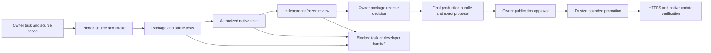

# OpenCode production lifecycle: audit and implementation proposal

Status: **PROPOSED — audit and design only**, 2026-10-23.

Extend the existing OpenCode manager/tester/reviewer and Toolkit adapters. The
repository already has most distribution mechanics; the missing work is safe
source intake, real-input adapters, version-specific qualification, durable release
state and an independently enforced human publication gate. No new orchestration
framework or agent role is needed. Routine releases should ultimately require
OpenCode, the owner and existing integrations, without a Codex operator.

This document grants no permissions. No adapters, profiles, packages, catalogs,
credentials, GitHub objects, Lab resources or services were changed for this audit.
The only additions are this proposal and ignored local audit evidence.

## 1. Verified starting state and evidence limits

The six required starting documents were read before adapter investigation.
Canonical `kodi-development/repository/ai-kodi-repository` is clean on main at
`f2d8f3330d76a982d6f66601d8ec6ae2bc9c9c83`; this is the required local commit.
Live GitHub main is `d6e1359a6668e688891359869ef2c7d34bc2ddff`, so the acceptance
documentation commit remains one commit ahead and **unpublished**. Live gh-pages
is `e66f5f6ac88450b92a5d1c5a2d43be70b86c513f`. There were no open PRs.
Five older topic branches remain remote; they are not pending implementation
authority. No branch was fetched, moved, committed or pushed by this audit.

A fresh detached worktree was created from canonical main at
`kodi-development/worktrees/ai-kodi-opencode-lifecycle-audit-20261023`.
The nine pre-existing registered worktrees were clean in tracked/untracked Git
status; ignored reports/intake/configuration were preserved. They include the
canonical checkout, six historical source worktrees, native-bootstrap worktree
and its nested approved-pages checkout. The fresh worktree deliberately has no
copied OpenCode configuration or adapters. The bootstrap profile is stricter than
canonical and must not be treated as a portable production profile.

Current production inputs contain Tastemade 0.1.0 for Omega only. The ledger pins
that ZIP and repository.ai.kodi 0.1.0. This is context, not a new release judgment.
The native acceptance record attributes repository/bootstrap installation and
Tastemade discovery/installation on Kodi 21.2 to the owner. Normal native updates
remain untested; the reported Tastemade launch error is unresolved and outside
this task. Neither the previous initial-release exception nor that installation
report qualifies a successor release or Nexus.

Read-only GitHub API observations:

| Item | Observed state | Design implication |
| --- | --- | --- |
| Pages | Legacy branch deployment, gh-pages root, built, HTTPS enforced | Preserve topology initially; a gh-pages push is a production operation |
| main / gh-pages | Both protection endpoints explicitly return `Branch not protected`; repository rulesets list is empty | Add reviewed protections before enabling agent publication |
| Environment | github-pages has a branch-policy rule, no required-reviewer rule | Existing environment is not a human publication gate |
| Workflows | Only GitHub's dynamic pages-build-deployment | No repository-owned promotion workflow exists |
| Default workflow permissions | Read; workflow PR approval disabled | Preserve these defaults |
| Release list, bounded 20 | One published tastemade-0.1.0, `immutable=false` | Local retention checks currently carry protection that the release itself lacks |
| Auditing account | Repository API reports admin/push permissions | This operator access is not an appropriate routine agent credential |

CLI OpenCode reports 1.19.3. Toolkit is clean at
`552b0b949220f2d545ab42a7f27d1826a535c686`; its environment reports Python 3.12.3,
Toolkit 0.1.0b1, Kodistubs 20.0.1, mypy 2.4.0 and checker 0.0.36. The metadata cache
was acquired on 2026-10-20. These are inspected pins, not new qualification.

[Private audit evidence](../reports/lifecycle-audit/evidence.json) records UTC
capture time, Git state, live GET projections, role permissions, safe configuration
projections and hashes of 24 relevant canonical files. Its SHA-256 is
`251d57a2e6cd793dc304e49658692d1348af530942dca884d9e6b8a6d56a8039`.
It is ignored and must not enter the public feed. Credentials/headers were not
read into it. This audit did not launch OpenCode roles, run add-on code, run
release qualification, query authenticated Lab state or reverify the live feed.
Effective permission/delegation behavior and deployed Lab capabilities therefore
remain implementation acceptance tests, not claims established here.

## 2. Capabilities and limitations matrix

The configuration facts below come from canonical ignored `opencode.json`,
`.opencode/agents/*.md`, `.opencode/tools/kodi.ts` and
`.opencode/control/agent-tools.py`. Distribution behavior comes from the tracked
scripts and contracts. Shared-fixture behavior comes from
`kodi-development/control/agent-tools.py` and `.opencode/tools/kodi.ts`.

| Capability | Existing implementation | Current agent limitation / required extension |
| --- | --- | --- |
| Coordination | Manager primary delegates to tester/reviewer; children cannot delegate | Keep; persist task/run identity rather than relying on conversation or shared report names |
| Developer handoff | Separate source ownership; distribution developer can inspect and write its handoff | No sibling source access/edit/build; acquire approved source into an isolated task workspace |
| Manifest/source discovery | Toolkit CLI discover, review-context, validate; repository ZIP inspection | Repository inspect returns fixed config/file/report lists; no bound real-source discovery or bounded source reader |
| Source acquisition | Owner/operator supplies ZIP and exact source provenance | No adapter for ref resolution, commit archive intake, nested add-on roots, LFS/submodules or upstream assets |
| GitHub reads | Manager-only fixed GET lists, four repositories, issues/pulls/releases, 20/page, pages 1..5 | Distribution repository absent; no arbitrary owner-approved source, refs/commits/files/details/checks; nonexhaustive |
| GitHub writes | Operator tooling available separately | No role has push, tag, PR/comment/release or Pages writer; preserve until approved implementation |
| Static validation | Repository adapter validates two Toolkit fixtures, always Nexus, then runs repository tests | Zero input arguments; no real add-on/lane selection |
| Other Kodi majors | Toolkit CLI accepts Matrix/Nexus/Omega/Piers and rejects stub-major mismatch | Installed stubs are Nexus only; syntax and mypy targets are fixed at Python 3.10; host Python 3.12 proves no embedded-runtime compatibility |
| Package construction | `repository.zip_bytes`, manifest/runtime/path checks, deterministic ZIP; shared adapter packages an explicit runtime list | Repository build builds fixture feed only; shared package adapter binds a single fixture scope and exact full source-file set |
| Real package intake | production/candidate schemas, ZIP/review-record hashes, per-file hashes, exact source commit, approval contract | Operator-controlled incoming/config only; roles cannot prepare real intake or authenticate source provenance from strings |
| Independent verification | audit_candidate reconstructs ZIP/feed/artwork/site/approval inventories independently of builder | kodi_review uses fixture plan/receipts and repo.verify; expose actual auditor over frozen real inputs |
| Feed preparation | Three script profiles, four lane catalogs, sidecars, artwork, bootstrap mirrors | kodi_build/qualify/review use fixture defaults; profile choice alone is insufficient without scoped input/output access |
| Dependencies/types | Required lane closure, explicit built-ins, cycles, optional warnings; no installer-only admission allowlist | External snapshots prohibited; built-ins only repository/Python APIs; directory module libraries unsupported; skin/native helpers need extension-specific rules |
| Version progression | Numeric x.y.z comparator, duplicate/version-byte rejection and historical retention | No general Kodi version comparator or old/new update planner; one selected version per ID/lane is enforced, increase over deployed selection is not a complete workflow |
| Qualification | Repeat-build site hashes, independent audit, loopback GET/HEAD, lane and bootstrap parser replay | No real add-on behavior or normal Kodi upgrade proof; qualify rebuilds, so cannot run against a reviewer-frozen release |
| Release plan | Full site/assets/hashes, config/ledger/toolchain/schema digests, blockers | proposed_tag is still repository-version based; generic create/push actions reflect initial infrastructure; ledger updates are manual |
| Publication preflight | check_publication rejects candidate/fixture, rechecks approvals/expiry, scans source/site/runtime, optional HTTPS | No publisher; needs owner authority, exact remote heads and independently authenticated approval |
| Native testing | Existing Toolkit testing instructions and separate Lab integration | Distribution profile disables both MCP servers; no role has target-control authority; deployed schema/grants not tested here |
| Post-publication checks | check_publication --https verifies expected full site, root discovery, sidecars and excluded paths | Not exposed to roles; no release-asset mirror checker/status reconciliation or native update adapter |
| Maintenance | Installer versions/root mirrors, historical downloads, catalogs, retained disclosures | Need bounded maintenance task types, retention reconstruction, storage accounting and explicit metadata-only proposals |
| Monitoring | Existing bounded GET lists and local proposed task cards | No subscriptions/scheduler; issue bodies, diffs/checks, upstream tag movement and approved-release state need fixed extensions |

Important implementation details:

- TypeScript pins the canonical directory and absolute plugin/Python paths; Python
  independently checks the exact canonical root. Changing one guard is not portable
  binding. The shared fixture adapter also pins ROOT and four-agent-scope.json.
- Manager currently has fixture inspect/build/qualify/review/GitHub/probe;
  tester inspect/validate/qualify/probe; reviewer inspect/review/probe;
  distribution developer inspect/probe. Direct edits are limited to one report
  per role. Reading incoming, dist/candidate and dist/production is not generally
  granted; a reviewer cannot independently examine frozen real ZIPs through those
  existing permissions. Use a bounded package/evidence reader rather than broad
  incoming access, which could disclose private review data.
- Repository roles deny shell, general search/list tools, configuration/credential
  reads, source edits and arbitrary delegation. Existing source scripts are
  readable. Skills do not override adapter schemas.
- The normal adapter subprocess has a scrubbed environment, shell=false and a
  timeout; stdout is capped but stderr is not. The GitHub TypeScript path lacks
  the same outer timeout/output bounds/stderr reporting; Python has a 180-second
  subprocess timeout. GitHub reads restore HOME to use the host gh credential.
  Retain bounded GETs but move them to a dedicated read-only credential context.
- No existing role boundary is an adversarial OS sandbox. HOME/environment
  scrubbing does not prevent same-user filesystem credential access. Toolkit
  explicitly describes its checker replay guard as application-level protection.
- Existing private candidate mode can fail its retained production-installer hash
  check because preview URLs change installer bytes. Treat that as a recorded
  limitation, not permission to discard the production ledger.
- All retained records are assessed again, including expiring v3 exceptions.
  Historical ZIP retention does not make expired decisions perpetually valid.
  Future preparation may require a reviewed successor decision for a retained
  artifact. No silent renewal, old-record rewrite or expiry bypass is proposed.

### Controls to preserve versus restrictions to generalize

Preserve deny-by-default roles, exact containment, separate source/distribution
ownership, no untrusted execution with secrets, archive/resource checks, immutable
ID/version bytes, per-lane evidence, independent auditor, honest unresolved
findings, no self-approval and explicit production authority.

Generalize fixed fixture identities, canonical-only binding, four-name GitHub
enumerations, zero-argument production tools, shared report filenames and
installer-centric release actions. Qualify new lane tooling and dependency/type
support explicitly. Unsupported input must return a named blocker rather than
weakening a security or approval gate.

## 3. Proposed task contract and adapter changes

Keep existing tool names where their responsibility fits. Add only missing
bounded operations; these names and schemas are proposals, not installed tools.

Introduce a versioned, operator-controlled task binding. Tool arguments reference
an opaque task_id/run_id and expected state digest, never arbitrary host paths,
commands, API endpoints or publication destinations. Validate schemas and roles
in both TypeScript and Python. Fail closed if workflow/binding/tool versions
disagree. Use a reviewed installation configuration for plugin/interpreter paths;
register exact worktree roots instead of discovering any repository directory.

Binding fields:

- Source repository numeric ID and owner/name, approved HTTPS origin, requested
  ref plus resolved 40-hex commit, source archive/tree digest, actual add-on root,
  manifest ID/version and runtime-file allowlist. Resolve branch/tag once; show
  owner the resolution. A moving ref cannot retarget an existing run.
- Distribution repository ID, expected main/gh-pages heads, baseline config/ledger
  digests, requested lanes/platforms and previous per-lane selected versions.
- Approved task worktree, immutable source/package/evidence storage, role-specific
  report paths and explicit writable outputs. Roots are canonicalized and linked
  paths rejected. Bind role/session/run in trusted adapter state; --role strings
  alone are not an authorization boundary outside OpenCode.
- Toolkit/toolchain/cache/stub/interpreter identities per lane, selected admission
  policy, applicable review decisions and native-test authority reference if any.
- Authorized stages: inspect, acquire, prepare, offline-test, review; optional
  native test scope; GitHub-write and publication scopes absent by default.
  Include expiry/revocation and state generation. A task cannot enroll another
  repository, grant a new stage or edit its own binding.

Trusted intake transitions may bind a discovered runtime inventory and advance
the state generation within already authorized source/preparation scope. The
manager submits structured selections; it cannot directly rewrite the binding.
Final owner release review binds the complete inventory. Routine operation must
not require a Codex operator to hand-edit scope files after every discovery.

Owner instruction naming a new GitHub repository can authorize that task's
read/intake/preparation scope after the adapter validates and displays its resolved
identity. It does not add a permanent wildcard allowlist entry. Private access,
repository transfers/renames, ambiguous multiple add-ons, different lanes, native
targets or executing build hooks require a decision where not already authorized.
Store source in the task workspace, preserving existing sibling add-on workspaces.

| Proposed surface | Role | Implementation / boundary |
| --- | --- | --- |
| kodi_inspect(task_id, section, cursor) | All four | Bounded manifest/tree/diff/evidence summaries; source reads only from the frozen approved snapshot; binary/archive inspection returns allowlisted metadata |
| kodi_github(task_id, resource, typed selector, page) | Manager | Extend fixed GET implementations to enrolled repos plus distribution; overview, ref/commit/tree/blob, bounded compare, issue/PR detail/checks, releases/assets; redact/limit output |
| kodi_intake(task_id, stage) | Manager | Resolve/acquire through trusted downloader, inventory and runtime selection proposal, copy approved bytes; no upstream scripts/config loaded |
| kodi_validate(task_id, lane, stage) | Tester | Existing Toolkit discover/validate/report-build in pinned isolated environment; preserve stages/warnings and reject unqualified target |
| kodi_build(task_id, stage) | Manager | Runtime package from approved allowlist via zip_bytes/inspect_zip; candidate/production feed via existing scripts; configuration/ledger patches generated only in task worktree |
| kodi_qualify(task_id, lane_set) | Tester; manager can request coordination | Existing repeat build, verify, auditor and loopback qualification on mutable preparation copy; freezes receipts only after settled bytes |
| kodi_review(task_id, frozen_bundle_digest) | Reviewer | Independent auditor plus bounded original ZIP/source/evidence access; separate scratch/reports; no rebuild, edit or acceptance creation |
| kodi_verify(task_id, verification_kind) | Tester/reviewer | Frozen local verification, approved deployed HTTPS, release mirror and remote-read reconciliation; writes only new receipts |
| Native test operation under existing adapter | Tester, separately scoped | Discover actual supported Lab schema/grants, exact disposable target/source generation and scenario; no general MCP control permission |
| Bounded GitHub write operation | Manager, conditional | Exact reviewed PR/issue/branch/merge action digest and target preconditions; absent from normal preparation scope |
| Publication request/status | Manager, conditional | Submit frozen promotion digest to trusted human gate; obtain no credential and cannot approve or modify request |

First extend project-local adapters; reuse Toolkit internals/CLI without changing
shared behavior. If branch-matched Python targets or extension validation require
Toolkit changes, qualify them in its own reviewed project/PR. No framework,
duplicated validator or new repository skill is required.

Source downloads accept GitHub-origin data only, enforce byte/file/time budgets,
validate every redirect and archive member and reject special/linked paths.
Disable Git hooks, filters, custom diff/textconv and credential prompting if Git
is used. Do not initialize submodules, fetch LFS, install requirements, execute
setup/build/tests or load upstream AGENTS/OpenCode/plugin configuration by default.
Repository text and issue instructions are data. Generated-source/binary/LFS cases
produce a concrete developer handoff or separately scoped sandbox-build proposal.

## 4. Roles, skills and instruction updates

Keep docs/AGENT-INTEGRATION.md as the sole standing workflow entry point. Update
it to the reviewed production adapter contract when implementation is accepted;
update heading checks and profiles together, without an interval where old tools
interpret new policy. Architecture/release/approval documents remain authoritative
for their respective policy. Dated reports never become current authority.

Reuse the five installed Toolkit skills unchanged initially:

| Skill | Required use in future routine workflow | Adapter/instruction alignment |
| --- | --- | --- |
| kodi-addon-development | Understand manifest, source root and entry points; developer handoff | Discovery through task binding; distribution manager does not edit independent source |
| kodi-addon-validation | Tester runs stages and reports failures/warnings | Map discover/validate/report commands to actual production schemas; no fixture substitution |
| kodi-version-compatibility | Separate each requested lane, API, Python/stub/cache and native scope | Missing matching tooling is BLOCKED/PARTIAL; no Nexus result copied to Omega |
| kodi-addon-debugging | Only a separately authorized reproducible defect investigation | Generate source-agent task card; no automatic scope expansion |
| kodi-mcp-testing | Explicitly authorized disposable native test | Actual tool/grant discovery; distinguish receipts, observations and feature acceptance |

Manager owns task coordination, intake and distribution proposals. Tester owns
machine qualification and scoped native evidence. Reviewer independently inspects
frozen source/ZIPs, evidence substance, retention, approval applicability and
proposed remote operations. Developer owns independent source fixes and handoff;
the repository handoff role remains a report-only bridge. Publication is a trusted
execution responsibility, not another reasoning agent. Rights and human decisions
must retain real attribution; separate model roles alone do not authenticate people.

Role prompts should point to contracts and exact run scope, enumerate stop states
and write only their run-specific reports. They must not duplicate approval policy.
Manager delegates only tester/reviewer, with same task/source/bundle identities;
children do not delegate. Use append-only receipt IDs to prevent one release's
TESTER/REVIEWER filenames being mistaken for another's evidence. Restrict raw
evidence by need; publish only separately reviewed notices and release notes.

Installed profiles/adapters are ignored today. Add reviewed, versioned templates
and an explicit local activation manifest with hashes/backup reference, then
generate exact-bound local profiles. A Git merge alone must not silently install
permissions. Keep model/provider, shared skills and unrelated profiles unchanged.

## 5. Tool and permission boundaries

| Stage | Minimum authority | Credentials / hard limits |
| --- | --- | --- |
| Discovery | Fixed GETs on named public/enrolled repos, bounded source/manifest/evidence reads | Public unauthenticated where possible; private Contents/Metadata/Pull requests/Issues/Checks/Commit statuses/Actions read only as endpoints require; no host gh HOME |
| Preparation | Task-local source acquisition, approved package/feed generation, narrow config/ledger patch generator | Dedicated scratch/home; read-only source; no shell, source edits, credentials, network build hooks, Docker socket or shared Toolkit writes |
| Offline testing | Pinned Toolkit/checker/stubs, readonly cache/source, disposable output | No release secret or host home; no egress beyond explicit acquisition; no untrusted test execution by default |
| Native testing | Exact disposable Lab target/source and permitted scenarios, expiry, existing server grants | Separate target credential; no household/production device access or infrastructure lifecycle authority |
| GitHub proposal/write | Exact repository/action/text/files/head digest, role and approval reference | PR/issue permission only if needed; Contents write for an approved draft branch, Pull requests write for PR/merge; no admin/workflow/secret changes; enforce paths in adapter |
| Promotion request | Dispatch/read status for one trusted workflow and immutable bundle | Scoped dispatcher identity; workflow dispatch needs Actions write, constrained further by adapter; no publish token or environment-approval API |
| Approved publication | Exact source/tag/assets/gh-pages commit and allowlisted repository after human gate | Short-lived single-repository Contents write for Releases/tag/branch promotion; no administration writes or upstream writes; restrict runtime operations by sealed plan |
| Verification/monitoring | Fixed GitHub GET and expected public HTTPS, plus separately approved native observations | Read-only; failure can propose recovery but cannot self-authorize a new write |

GitHub token scopes do not restrict Contents write to just one tag or branch.
Use repository protections, trusted plan enforcement and short lifetime as well.
No role receives persistent unrestricted Contents/Pages write. PR creation or
source merge does not authorize publication; a gh-pages push does.

Keep publication-policy discovery in the trusted verifier: endpoint-specific
Actions/Pages read permissions for environment/deployment state, and
Administration **read** for classic branch-protection inspection. Do not grant
Administration write or expose policy mutation to roles. If the verifier cannot
read the actual protection state, stop instead of interpreting access denial as
an unprotected/approved repository. GitHub's
[branch-protection API](https://docs.github.com/en/rest/branches/branch-protection#get-branch-protection)
requires that distinct read permission.

Isolate acquired source and any approved execution at OS level using the existing
execution facilities under separate activation authority: no host home, gh/auth
files, agent configurations, SSH agent, cloud credentials, sockets or writable
trusted tooling. Dedicated identities/mounts and readonly frozen inputs must
enforce this, not prompts or environment variables alone. Sandbox qualification is
a prerequisite for arbitrary untrusted-code execution; if unavailable, execution
stays blocked while inspection/package preparation continues safely.

The publisher consumes data only: safe archive extraction, known inventory and
digests, trusted pinned verifier, fixed API calls. It never imports producer code,
runs source tests/builds, restores producer caches or runs executables contained
in the submitted bundle. Its trusted verifier/workflow comes from a protected
reviewed revision, not the untrusted proposed distribution branch. Owner approval
cannot turn a malicious payload into trusted publisher code.

For initial minimal adoption, retain gh-pages branch deployment and place the
human gate **before both release writes and the gh-pages push**. Adding only a
reviewer to github-pages would leave earlier Release uploads ungated. Prefer a
separate protected promotion environment with the owner required, self-review and
admin bypass disabled. OpenCode's dispatcher should be a distinct scoped App
identity so the owner can review its run. Do not quietly use the owner's own
identity to dispatch and then disable self-review when approval is blocked.
GitHub documents these environment controls in
[Managing environments](https://docs.github.com/en/actions/how-tos/deploy/configure-and-manage-deployments/manage-environments).

A repository-scoped App credential can be issued for a bounded run; GitHub
installation tokens expire after one hour and can be narrowed by repositories
and permissions. Keep App key/token creation outside agent-accessible storage.
See [installation access tokens](https://docs.github.com/en/apps/creating-github-apps/authenticating-with-a-github-app/generating-an-installation-access-token-for-a-github-app).
Credential provisioning and GitHub policy changes require separate approval.

Do not assume a gh-pages push from an Actions GITHUB_TOKEN triggers branch Pages
publication: GitHub explicitly excludes that trigger. Qualify an approved App
token path or separately approve migration to manual Actions Pages deployment.
[Publishing-source behavior](https://docs.github.com/en/pages/getting-started-with-github-pages/configuring-a-publishing-source-for-your-github-pages-site).
An optional later Actions Pages mode requires pages:write and id-token:write on
the protected deploy job, without granting those permissions to preparation.
[Custom Pages workflows](https://docs.github.com/en/pages/getting-started-with-github-pages/using-custom-workflows-with-github-pages).

## 6. End-to-end operating workflow

These are release states in the existing adapters, not a new workflow engine.
Persist state/receipts with a per-distribution promotion lock, generation
compare-and-write under that lock, append-only transition records and an explicit
RECONCILIATION_REQUIRED state. Atomic file replacement alone does not prevent a
stale session from overwriting current state. A timeout after a remote request is
ambiguous; reconcile exact remote identity before any repeat. Never automatically
retry an ambiguous write with a new identity.

### New admission

1. Parse the owner's repo/ref/lanes; resolve immutable identity, show the scope,
   create the binding and capture published baseline. If only a repository URL
   is supplied, propose its latest eligible source release; do not equate latest
   release with owner approval. Ask only for material unresolved choices.
2. Inspect actual packaging conventions, nested roots, manifest extension/category,
   compatibility and source-to-artifact provenance. Prepare a runtime allowlist;
   use manifest provides/extension points for native categories, not custom menus.
   Review every distributed material, licenses/notices, service findings and
   dependency closure. Record blockers with exact source/evidence references.
3. Acquire/export only the pinned source into a task sandbox. Package approved
   runtime members using existing zip_bytes and inspect_zip, record per-file,
   archive and source mapping hashes. Build twice in the pinned environment;
   retain clean/dirty disposition and toolchain/compressor identity.
4. Tester runs available matching-lane static checks and required offline tests.
   Independent native scenarios run only with existing exact target authority.
   Missing cache/stubs/typing/native capabilities remain missing; no fabricated
   positive records. Before genuine decisions, candidate review records retain
   pending/false fields and cannot pass publication preflight.
5. Reviewer inspects original frozen inputs and runs independent audit, checks
   substantive evidence/rights and reports exact lane/feature limitations.
   Required unknown/failed stages block the chosen policy. Only an explicitly
   eligible existing exception may be proposed, with real separate owner decision.
6. Present owner the package release decision and any necessary separate risk
   decisions. After genuine decisions, generate hash-bound successor review
   records and exact production intake/ledger patch locally. Never have a model
   invent actor identity, timestamps or approval evidence.
7. Reuse production build/verify/audit/qualify/preflight on settled inputs, freeze
   complete site and assets, and obtain independent review of the final bundle.
   Changed metadata requires fresh plan/review; it does not require rebuilding an
   unchanged frozen ZIP. Production plan flags remain publication_authorized=false.
8. Present exact publication proposal; wait for authenticated owner approval;
   execute bounded promotion and verification described below.

### Existing add-on update

Use the same flow, additionally bind old/new source commit, addon ID, source
repository identity, version and per-lane selected packages. Compare behavioral,
license/artwork/dependency/API changes and reconsider relevant runtime scenarios.
Reject ID takeover, unapproved repository change, retagged source, same version
with different bytes, or non-increasing normal update versions. Already-published
identical bytes are an idempotent observation, not a new release.

Select exactly one approved version per ID/lane. Retain old ZIPs, sidecars,
original review records and release assets; generate a hash-bound successor
retention record where changing active lane membership requires it. Never edit
old approval evidence in place. Append the new ledger identity/hash without
reordering history. Compare the proposed ledger with the observed published
baseline so newly frozen artifacts cannot be omitted at the next release.

Requalify every requested lane. No prior first-release runtime exception extends
to a successor. Expired retained-artifact decisions require real renewed review
under the existing contract, or a separately proposed policy change; they cannot
be skipped because another add-on is being released.

Test native normal updates on an authorized disposable profile: install the old
version through the repository, refresh unchanged metadata and confirm no false
update, offer the higher approved version, use Kodi's normal update path, then
read installed version/dependencies and observe scoped behavior/settings retention.
Direct ZIP reinstall or successful feed download is not this test. Test lane
exclusion as well. After public promotion, verify the actual production feed on
the approved target; keep that result separate from earlier staged-feed evidence.

For prepublication update tests, use a separately reviewed test repository
identity and reachable isolated feed with an immutable mapping to the exact add-on
ZIPs. Maintain its own test ledger and truthful test records; never reset/drop the
production ledger or install its candidate-preview installer. A supported native
repository/update test route and feed reachability are activation prerequisites.
The existing Lab workspace deployment path, if available, is not automatically
proof of this distribution repository's normal update mechanism.

### Installer, bootstrap and repository maintenance

Installer updates follow normal ID/version/retention and exact approval rules.
Retain previous nested/root ZIPs and sidecars; select the current link through the
generator. Preserve Matrix-compatible anchor format and independent reconstruction
tests. Ordinary add-ons remain catalog-only; no per-add-on bootstrap links.

Metadata/index/documentation-only proposals must prove unchanged package/sidecar/
approval bytes and list their exact changed public paths. Rebuild/audit all lane
catalogs and preserve all historical downloads/disclosures. Track site size and
hosting-limit trends. Any CDN/storage migration or withdrawal is a separately
reviewed operation; no automatic garbage collection of published packages.

## 7. Release proposal and publication approval

Retain existing review-record schemas and rights/runtime/final decisions. Add a
separate publication authorization envelope; never treat release_approved, a
reviewer PASS, a local approval JSON or an OpenCode tool confirmation as the owner
publication decision. Existing records use attributable strings, not authenticated
signatures; that distinction must remain visible.

Recommended initial owner experience has **two checkpoints** because today's
production builder requires completed package decisions before final feed creation:
first the package/policy release decision, then publication of the frozen resulting
site. Neither implicitly approves the other. A future single interaction is
possible only with a separately reviewed exact decision-materialization contract;
do not close the current circularity by marking pending decisions approved for a
preview. Source enrollment and native execution may need additional decisions
where the original task did not supply those scopes.

The final proposal/envelope must bind:

- proposal/run ID, owner/repository numeric identity and audience, allowed operation
  list, expiry, nonce and trusted workflow/verifier revision;
- every upstream source repository/commit/tree, add-on ID/version, runtime inventory,
  ZIP digest and source-to-package mapping;
- policy/schema/toolchain/cache identities, complete review-record and evidence
  manifest digests, final tester/reviewer report digests and all disclosed limits;
- distribution source commit/tree and exact proposed config/ledger diffs, previous
  ledger digest and planned successor ledger digest;
- existing main/gh-pages heads, proposed source and Pages trees/commits, complete
  site manifest, catalog/artwork/bootstrap hashes and immutable asset inventory;
- exact release tag target, name/notes/body digest, asset names/hashes, checksum
  files, hosting mode and allowed hostname/path;
- recoverable prior site/ledger/assets snapshot digest, independently verified
  restore instructions and verification/native-target scope;
- authenticated owner decision reference, decision time, execution journal and
  consumption state stored outside manager/source-writable storage.

Use the GitHub required-owner environment decision on the trusted run as the
initial authenticated publication gate; show this exact digest/manifest to the
reviewer. A run input string alone is not approval. Only the trusted executor can
associate the environment approval/run ID with its sealed request and consume it.
Models can prepare the request but cannot mint or mutate authorization. Approval
of one run grants only its listed operations. Reusing an unconsumed step after
reconciliation is bounded to identical remote identities; a new release or changed
digest/head needs fresh review and owner approval.

Replace the infrastructure-era proposed_tag/action template with a typed promotion
plan: add-on release `<addon-id>-<version>`, installer release
`repository-<version>`, or unique metadata/site release identity. Bind actual tag
commit, not target_commitish=main. For multiple add-ons choose explicitly separate
per-add-on tags or a unique immutable batch tag; never reuse an old tag or rewrite
its SHA256SUMS. Preserve full-site recovery manifests separately from per-release
new-asset checksum lists. Existing builder release-assets includes historical
packages: classify existing verified mirrors versus genuinely new uploads; do
not attempt to upload all history to every tag by default.

Production execution, all inside approved scope:

1. Acquire release lock; re-read remote heads, protections, owner decision/expiry,
   config/ledger and all frozen digests. Re-run trusted independent preflight on
   frozen inputs without executing producer code. Reconcile retained live assets
   and independently recover-test the prior snapshot. Drift stops before writes.
2. Integrate only the approved distribution source change through its approved
   normal branch/PR path. If merge produces an unapproved source identity, freeze
   and review that result before publication. This also means the local pending
   documentation commit cannot ride along without explicit owner approval.
3. Create the exact new tag/draft Release and upload only new approved bytes.
   Verify downloaded assets and checksum lists, then publish the completed release.
   Prefer GitHub immutable releases for future releases after separately approved
   configuration. GitHub recommends attaching all draft assets before publication;
   [immutable releases](https://docs.github.com/en/code-security/concepts/supply-chain-security/immutable-releases)
   protect published tags/assets, while release notes still require digest checks.
4. Materialize the approved full site in a separate gh-pages checkout, compare
   every file and prior retained package, make one normal pinned fast-forward
   push under the promotion lock and verify resulting remote tree. No force/admin
   bypass, asset replacement or arbitrary branch operations are exposed.
5. Observe Pages deployment, bounded retries for cache convergence, then expected
   public HTTPS GET/HEAD for the entire site, root/index MIME/parser checks,
   catalogs/sidecars/packages/artwork/bootstrap and negative private-profile paths.
   Separately verify release mirrors including their allowed download redirects.
6. Run separately authorized production-feed native refresh/update observations.
   Record source/site/Release/Pages operation IDs, all receipts and final ledger.
   Report package, HTTPS, deployment and native results separately. No native
   observation means pending native verification, not complete lifecycle PASS.

The existing checker reassesses current approval eligibility even for HTTPS
verification. If an expiry blocks a later observational check, preserve that
policy failure and separately report any bounded byte-retrieval observations;
neither renew an approval nor falsely claim full preflight PASS.

## 8. Monitoring and owner experience

On demand, the manager should accept:

> Add this GitHub Kodi add-on to AI Kodi Repository for Omega and Nexus.

It resolves the supplied source, inventories packaging/compatibility, asks only
for missing material choices, prepares package/testing/review evidence and returns
an actionable release decision. Each lane has its own status. An unsupported
dependency, missing Omega tooling or absent native grant yields a concrete blocker
and task card; it never substitutes the Nexus fixtures.

> Update Tastemade in AI Kodi Repository using its latest approved source release.

It consults the owner-approved source-release registry/evidence, resolves that
release's exact commit, compares the published baseline and follows the same update
pipeline. GitHub latest, a new tag and a previous version's approval are not approval
of a new source release. If no approved successor exists, present eligible choices
or report no approved update. Existing launch-error evidence must be addressed in
that release's source/qualification scope, not hidden by previous acceptance.

After the final authenticated approval, the trusted executor publishes; OpenCode
tracks status and reports exact results/limitations. No Codex step is required once
these adapters, owner channel and tests are accepted. Exceptional source changes,
credential recovery, infrastructure or policy changes remain separately scoped.

Monitoring starts on demand with the extended existing GET adapter:

1. Watch only an owner-enrolled repository list: distribution issues/PRs plus
   upstream releases/tags/selected branches and relevant Toolkit/Lab changes.
2. Compare with an explicit previous snapshot. Record UTC, repository ID,
   ETag/last-modified where supported, page coverage/Link-next, rate-limit/access
   status and stable item/commit IDs. Cache hits do not hide fetch failures;
   forbidden access is BLOCKED, not empty. Pagination remains bounded and labeled.
3. Fetch allowlisted detail, PR head/base, changed-file scope, checks and source
   release commit. Detect changed tags/assets and version/security/dependency
   concerns. Titles alone cannot establish compatibility or a verified defect.
4. Reviewer examines material findings. Deduplicate proposed task cards by
   repo/item/revision, classify urgent defects versus normal updates/questions,
   and report observed facts, affected versions, proposed work, acceptance tests
   and owner decisions. Do not run untrusted PR workflows/code with secrets.
5. Write local report/cards only. Exact comments/labels/issues/PRs/merges need their
   own reviewed GitHub-write scope. Monitoring never approves source or publication.

A later owner-approved scheduled read/report-only job may use existing GitHub
Actions or existing scheduling facilities, with chosen cadence and report
destination. No new daemon/service, webhook, timer or subscription is part of
this proposal's initial implementation. A scheduled discovery event must have no
path to a promotion token; publication remains manual and human approved.

## 9. Incremental implementation and qualification

Each row is a separately reviewable scope. Implementation and activation are
distinct; production publication is the final separate authorization.

| Phase | Changes | Exit criteria |
| --- | --- | --- |
| A — contracts and local binding | Versioned adapter/profile templates; schema/task roots/state transitions; fixed GET/source reader; role report IDs | Two unrelated approved sources and fresh worktrees work; canonical/foreign roots and self-enrollment reject; existing profile remains default |
| B — intake and offline preparation | Trusted acquire/export, allowlist packaging, real validate/build/review/qualify adapters, local config/ledger patch generator | Pinned independent add-on and successor package reproducibly; production/candidate/fixture remain separate; no remote writes or native authority |
| C — compatibility/dependencies | Separate qualified Nexus/Omega tooling and Python targets first; reviewed external dependency snapshot/built-in/module support as needed | Each target/tool/cache identity proved independently; missing lane fails; both auditor and builder enforce identical reviewed dependency policy independently |
| D — OpenCode lifecycle pilot | Manager delegation, independent frozen review, owner decision intake, maintenance/update workflow; authorized disposable native tests | Ordinary owner task completes preparation without Codex shell steps; old-to-new normal update and unchanged-version behavior observed on each claimed lane |
| E — gated publisher | Trusted manually dispatched workflow/executor, owner-only environment, scoped credentials, protection/retention checks, exact promotion and recovery journal | No human approval means zero production writes; approval/head/digest drift rejects; full sandbox-repo release/feed recovery exercise passes |
| F — controlled production adoption | Explicit profile activation; exact approved real release; HTTPS/mirror/native verification | One owner-approved production release plus independently checked preservation/recovery; routine handover accepted |
| G — monitoring/maintenance | Bounded snapshots, detail reads, reviewer task cards; optional separately approved scheduled reports | No automatic issue mutations or publishing; omissions/errors and deduplication tested; owner chooses cadence/destination |

For B, use production scripts' existing APIs rather than replacement feed code.
Separate phase C dependency snapshots from cache acquisition: checker's official
index is evidence for static checks, not authority to redistribute or blindly
trust external packages. A snapshot adapter must bind origin/lane/index/package
hashes and transitive closure, preserve official/third-party provenance, and avoid
claiming mirrored packages are independently developed. No external dependency
support ships through an unreviewed empty-dictionary bypass.

Qualification strategy:

- Preserve the existing hostile-archive, intake, approval v1/v2/v3, owner-risk,
  runtime-exception, retention and bootstrap tests. Their synthetic positive
  approvals remain test-only. Run the full existing suite once on settled changes;
  use focused tests while implementing. This design audit ran none of them.
- Binding/credential tests: traversal, symlink ancestors/TOCTOU, worktree swaps,
  unapproved repo ID/ref drift, oversized archives, LFS/submodules, injected
  instructions/config/plugins/hooks, altered task bindings and source modification
  during packaging. Confirm no host home/token/SSH/Docker access or secret-bearing
  environment/output for test code.
- Adapter tests must cross the actual TypeScript-to-Python JSON/process boundary
  and OpenCode permission/delegation engine, including wrong-role/session calls,
  abort/timeout/output limits, error propagation and finite pagination. Test both
  fixed canaries and rejected real operations in a disposable environment; a
  canary's ALLOW/DENY alone does not establish execution containment.
- Packaging/update tests: nested source root, multi-add-on ambiguity, exact source
  mapping, non-runtime exclusion, genuine licenses/assets, extension/category
  rules, numeric progression/duplicates, changed bytes at old identity, old/new
  lane selection, historical record/ZIP retention and append-only ledger. Broader
  Kodi suffix/epoch comparison requires upstream-equivalent fixtures before enable.
- Compatibility tests: matching and mismatched stub majors, Python syntax target,
  unsupported modules/binaries/GUI APIs, offline cache mismatch/staleness, required
  dependency floors/cycles/transitive snapshots and optional-warning retention.
- Review tests: independently inspect original frozen ZIP/source, reconstruct full
  inventory, forged plan/approval/evidence digest, missing private evidence,
  stale report, v3 expiry/first-release limits, malicious shared-contract behavior
  and a preparation mutation after reviewer freeze.
- Publication failure controls: no approval, forged local approval, self-approval,
  wrong repo/audience/nonce, expired/revoked/replayed approval, wrong trusted
  verifier, changed head/asset/site/ledger, concurrent releases, unrelated files,
  same-tag replacement and lost-response ambiguity. Assert zero unauthorized writes.
- In a separately approved test GitHub repository, exercise source/Release/Pages
  ordering, upload/deployment failure, mixed cache bytes, mirror redirects, public
  checksums and denied private paths; restore the complete site while retaining
  packages. Then qualify an independently developed frozen add-on and successor
  on explicit disposable Nexus/Omega targets. Neither fixtures nor loopback prove
  real add-on behavior or production update acceptance.

Normal upgrades must not decrease the lane-selected version. Start with current
x.y.z support and return BLOCKED for other valid Kodi version forms; extending the
comparator is a distinct tested change in every consumer. Likewise declare the
supported add-on extension/platform subset explicitly. A reusable workflow can
handle arbitrary approved repositories while honestly blocking unimplemented
types; it cannot promise every Kodi package is qualified on day one.

## 10. Migration, recovery and rollback

Before activation, preserve the exact ignored canonical profiles/adapters,
trusted dependencies, permissions, skill paths and state; independently verify a
restore copy. Version the new templates/bindings and activation manifest. Pilot
only isolated roots with credential-free defaults, then activate canonical under
separate approval. Do not copy the bootstrap review profile over canonical or
rewrite old reports/approval records. Preserve all existing worktrees/intake.

Rollback of local adapter activation restores prior files and denies new tool
operations without deleting journals/artifacts. Cancel/revoke pending promotion
requests and credentials; complete reconciliation of ambiguous writes before
resuming. Shared Toolkit changes, if any, require their independently recoverable
pin/venv rollback. No Kodi Lab infrastructure migration is included.

Every production release preserves a full independently checked prior site,
source/config/ledger and retained assets, not merely an observation log. If a
release partially succeeds, keep any new immutable assets and report the exact
remote state; do not delete/reupload them to pretend atomicity. Resume only the
remaining explicitly approved identical operations after reconciliation.

For a bad catalog/site, prepare a **new forward commit** restoring coherent
selected metadata while retaining the union of all published ZIPs, sidecars,
applicable disclosures and ledger entries, including any just-published version.
Do not reset/force gh-pages to an old tree that drops new downloads. Recovery
writes require a concrete owner-approved recovery proposal unless those exact
contingency operations/trees were already included in the original approval.

Restoring catalogs does not downgrade installed add-ons. Prefer a corrective
higher source version; any manual downgrade/profile restore needs separate target
authority and recoverable profile backup. Check HTTPS and native observations
again and retain failure evidence. GitHub metadata/tag immutability and package
retention remain intact during recovery.

## 11. Decisions for owner review

These are decisions on this concrete proposal, not requests to change anything
during the audit:

1. Approve implementation of A/B first, restricted to isolated local preparation,
   versioned contracts/templates and fixed read-only intake. Keep production
   adapter activation and the pending f2d8f333 documentation push separate.
2. Approve task-scoped enrollment of owner-supplied GitHub repositories and the
   bounded GET/detail/source extensions; choose any private-source access scope.
   No wildcard repository/endpoint or persistent write credential is proposed.
3. Confirm initial supported scope: Nexus/Omega Python add-ons using x.y.z, then
   separately qualify other lanes/extensions/version forms and external dependency
   snapshots. Confirm native targets/scenarios and authority when selecting a pilot.
4. Confirm two owner checkpoints: truthful package/policy decision followed by
   exact site/publication approval. Existing rights/runtime policies remain intact;
   renew any retained expiring decisions only through explicit successor review.
5. Approve E separately: protection rules, distinct dispatcher identity,
   owner-required promotion environment, no self-approval/bypass, short-lived
   repository-scoped credential and trusted pinned workflow. Retain branch Pages
   initially; Actions Pages migration is optional and separately approved.
6. Choose immutable per-add-on release tags and a unique metadata/batch identity;
   approve future-release immutability after recovery tests. Do not alter existing
   published assets/tags or automatically migrate live records.
7. Select the independent add-on and successor for full lifecycle qualification,
   test GitHub repository and disposable native targets. Production publication
   requires its own exact artifact/head approval after that pilot passes.
8. Start monitoring on demand. Decide cadence/destination and exact remote write
   scopes only if later adopting scheduled reports or issue/PR actions. No
   unattended publication at any phase.

The next implementation task can therefore be bounded to A/B with concrete
negative tests and a local real-input demonstration. C through F each add a
separately reviewed capability; completion requires operational evidence, not
merely amended prompts or permissive tool names.
